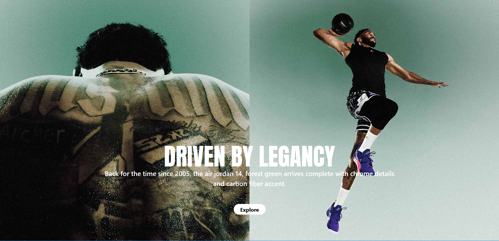

<div align="center">


# NIKE

<div align="center">





</div>


**A bold, responsive landing page inspired by Nike and the Air Jordan legacy.**


](https://zhraakbariweb.github.io/nike/)


[🌐 Live Demo](https://zhraakbariweb.github.io/nike/) · [🐛 Report Bug](../../issues) · [✨ Request Feature](../../issues)

</div>

---

## 📖 About

**NIKE** is a modern, fully responsive front-end project that recreates the look and feel of Nike's sneaker storefront. It highlights the **Air Jordan** line with large product imagery, bold typography and clean call-to-action sections, including the **Air Jordan 14 "Forest Green"** and the **Air Jordan 11 "Magic Ball"** from the Jordan Brand x Space Jam collection.

> 🔗 **Live:** https://zhraakbariweb.github.io/nike/

---

## ✨ Features

- 👟 **Hero section** with the slogan *"Just Do It"* and Jordan showcase
- 🧭 **Clean navigation:** Men, Women, Jordan, Kids, Accessories
- 🏷️ **Category menu:** New Arrivals, Shoes, Jordan Sport, Clothing, Accessories
- 🔥 **Featured collections** with large product images and "Explore" buttons
- 🔤 **Custom typography** using Anton SC and UnifrakturMaguntia fonts
- 📱 **Fully responsive** across mobile, tablet and desktop
- ⚡ **Lightweight and fast**, built with utility-first CSS
- 🚀 **Deployed on GitHub Pages**

---

## 🛠️ Tech Stack

| Technology | Purpose |
|------------|---------|
| **HTML5** | Page structure and semantics |
| **Tailwind CSS** | Utility-first styling and responsive layout |
| **JavaScript** | Interactivity and UI behavior |
| **GitHub Pages** | Hosting and deployment |

---

## 📂 Project Structure

```
nike/
├── assets/
│   ├── css/
│   │   ├── input.css
│   │   └── output.css
│   ├── font/
│   │   ├── AntonSC-Regular.ttf
│   │   └── UnifrakturMaguntia-Regular.ttf
│   └── img/
├── index.html
└── README.md
```

---

## 🚀 Getting Started

Clone the repository and open it locally:

```bash
# Clone the repo
git clone https://github.com/zhraakbariweb/nike.git

# Go to the project folder
cd nike

# Open index.html in your browser
```

Or use a local server such as the VS Code **Live Server** extension.

### 🎨 Working with Tailwind

If you want to edit the styles, install dependencies and run the Tailwind build:

```bash
npm install
npx tailwindcss -i ./assets/css/input.css -o ./assets/css/output.css --watch
```

---

## 🗺️ Roadmap

- [x] Responsive hero section
- [x] Main navigation
- [x] Featured Jordan collections
- [ ] Shopping cart
- [ ] Product detail pages
- [ ] Dark / Light mode
- [ ] Animations and transitions

---

## 🤝 Contributing

Contributions are welcome!

1. Fork the project
2. Create your branch: `git checkout -b feature/AmazingFeature`
3. Commit your changes: `git commit -m "Add AmazingFeature"`
4. Push to the branch: `git push origin feature/AmazingFeature`
5. Open a Pull Request

---

## ⚠️ Disclaimer

This is a **non-commercial, educational project** created for learning and portfolio purposes. All trademarks, logos, product names and images belong to **Nike, Inc.** and **Jordan Brand**. This project is not affiliated with or endorsed by Nike.

---

## 📄 License

Distributed under the **MIT License**. See `LICENSE` for more information.

---

<div align="center">

Made with ❤️ by [zhraakbariweb](https://github.com/zhraakbariweb)

⭐ If you like this project, give it a star!

</div>
```
